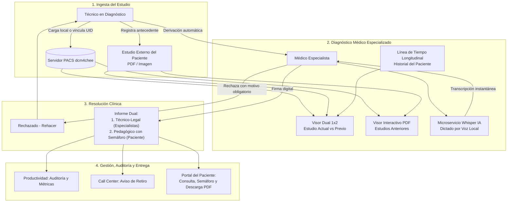

<div align="center">


# ReportFlow

### Plataforma Integrada de Diagnóstico Médico, Visor Dual e Inteligencia Clínica
**Hospital Universitario — Universidad Nacional de Cuyo**

[](https://laravel.com)
[](https://www.php.net)
[](https://www.mysql.com)
[](https://tailwindcss.com)
[](https://alpinejs.dev)
[](https://www.dcm4che.org/)
[-10B981?style=flat-square)](https://openai.com/research/whisper)
[-003764?style=flat-square)](https://github.com/Scomes02/ReportFlow)
[]()

</div>

---

## 📋 Descripción del proyecto

**ReportFlow** es una plataforma web hospitalaria integral diseñada para el **Hospital Universitario (UNCuyo)** que digitaliza, acelera y humaniza el circuito completo del diagnóstico por imágenes y estudios complementarios. 

El sistema conecta de punta a punta a los diferentes actores del ecosistema hospitalario:
1. **El Técnico en Radiología / Diagnóstico**, que carga placas, vincula estudios a servidores PACS DICOM y digitaliza antecedentes externos.
2. **El Médico Especialista**, que cuenta con una estación de diagnóstico equipada con **Visor Comparativo Dual 1x2**, visualizador de **PDFs interactivo**, correlación de antecedentes longitudinales y **dictado médico por voz con IA on-premise**.
3. **El Paciente**, que accede a un **Portal de Salud** con un informe explicativo comprensible acompañado de semáforos evolutivos.
4. **Productividad y Auditoría**, que monitorean el rendimiento y volumen de estudios por especialidad sin comprometer la privacidad médica.
5. **Call Center**, que gestiona la comunicación y aviso de retiro de informes manteniendo estricto aislamiento de los diagnósticos clínicos.

Todo el ecosistema está resguardado por una capa de **Doble Factor de Autenticación (2FA)** por correo electrónico, adaptada con modo de demostración ágil para evaluaciones y modo hospitalario estricto para producción.

---

## 🎯 El problema clínico que resuelve

En la práctica médica tradicional:
- **Diagnóstico fragmentado:** Cuando un paciente asiste con un estudio anterior de otro centro médico (muchas veces en papel, CD o PDF), el médico no cuenta con una herramienta ágil para compararlo sincrónicamente con el estudio del día.
- **Sobrecarga y fatiga médica:** La redacción manual reiterativa de informes ralentiza la entrega de resultados y consume tiempo valioso de atención clínica.
- **Incertidumbre del paciente:** Los pacientes suelen recibir documentos cargados de tecnicismos complejos sin una explicación clara de su estado evolutivo.
- **Silos de información:** No existía una correlación ágil entre antecedentes de distintas especialidades (por ejemplo, hallazgos cardiológicos previos al evaluar una placa pulmonar).

**ReportFlow** supera estas barreras proveyendo herramientas avanzadas de interoperabilidad médica y una arquitectura orientada a la experiencia de cada usuario.

---

## ✨ Características principales por módulo

### 🧪 Módulo Técnico
- **Carga de nuevos estudios:** Registro de datos del paciente (nombre, DNI, edad, contacto) y archivos médicos locales (PDF, JPG, PNG, DICOM `.dcm` hasta 50MB).
- **Integración con Servidores PACS (dcm4chee):** Vinculación directa mediante `StudyInstanceUID`, modalidad (`CR`, `CT`, `MR`, `DX`, `US`, `XA`) y `Accession Number`.
- **Registro de Estudios Previos Externos:** Casilla para registrar estudios históricos traídos por el paciente desde otras clínicas o sanatorios, documentando la institución de procedencia.
- **Derivación automática:** Asignación inmediata a la especialidad y tipo de estudio correspondiente.
- **Trazabilidad:** Historial de estudios subidos con seguimiento de estados y visualización de motivos de rechazo cuando un médico solicita rehacer una toma.

---

### 🩺 Módulo Médico — Centro de Diagnóstico Avanzado
- **Worklist Especializada:** Bandeja de estudios pendientes filtrada automáticamente según la especialidad del médico autenticado.
- **Visor Comparativo Dual Lado a Lado (1x2):**
  - Panel izquierdo: Estudio actual del paciente.
  - Panel derecho: Estudio previo comparativo seleccionado.
  - **Herramientas diagnósticas:** Manipulación de Ventana y Nivel W/L con presets (*Hueso*, *Pulmón*, *Tejido blando*, *Invertir*), regla milimétrica digital calibrada, rotación 90°, zoom sincronizado y restablecimiento 1:1.
- **Gestión Nativa de Estudios Externos en PDF:**
  - Si el antecedente traído por el paciente es un PDF (informe o digitalización previa), el visor comparativo incrusta un **lector PDF interactivo** lado a lado.
  - Acciones directas para **abrir en pestaña completa** (ideal para imprimir) o **descargar el archivo original**.
  - Botón directo `[➕ Aportar Estudio Anterior]` para adjuntar antecedentes históricos en cualquier momento durante la consulta.
- **Línea de Tiempo Clínica Longitudinal (Timeline):**
  - Tira interactiva deslizante con todos los estudios históricos del paciente.
  - Distintivos visuales por modalidad, etiqueta `ACTUAL`, carteles `🏥 EXTERNO: [Institución]`, badges `PDF` y semáforos de salud previos.
- **Dictado por Voz Inteligente con IA On-Premise (Whisper Local):**
  - Reconocimiento de voz médico en tiempo real sin salir de la pantalla de informe.
  - **100% On-Premise:** Utiliza un microservicio en Python con el modelo Whisper de OpenAI ejecutado en el servidor local.
  - **Máxima privacidad y confidencialidad:** Cumple con la normativa de protección de datos de salud y secreto médico (cero envío de audios a internet y sin costos de consumo de APIs).
  - Encendido automático en segundo plano desde la interfaz con botón `⚡ Conectar Dictado`.
- **Modelo de Informe Dual:**
  - **Pestaña 1 (Informe Médico Formal):** Diagnóstico técnico-legal destinado a especialistas y médicos derivantes.
  - **Pestaña 2 (Evolución del Paciente):** Explicación clara y accesible para el paciente, acompañada por un **Semáforo de Salud** de 4 estados:
    - 🟢 *Favorable / Normal* (Sin hallazgos de alarma).
    - 🔵 *Estable sin cambios* (Evolución controlada idéntica a previos).
    - 🟡 *Control Periódico* (Seguimiento recomendado a 3/6 meses).
    - 🔴 *Atención Inmediata* (Hallazgo prioritario para consulta médica urgente).
- **Cruce Multidisciplinario y Mosaico Clínico:** Detección de estudios previos en otras especialidades y evaluación del estado general del paciente.
- **Ventana de edición de 24 horas y Adendas:** Posibilidad de corregir el informe durante las primeras 24hs posteriores a la firma; luego de ese plazo, se garantiza la inmutabilidad legal mediante el registro de **adendas** anexas.
- **Flujo de Rechazo ("Rehacer"):** Devolución fundada al técnico con motivo obligatorio para subsanar errores en la captura de imágenes.

---

### 👤 Módulo Paciente — Portal de Salud Digital
- **Acceso web seguro:** Acceso directo al informe firmado (`/portal/paciente/estudio/{id}`).
- **Comprensión clínica:** El paciente visualiza su diagnóstico simplificado y el semáforo evolutivo de su salud.
- **Impresión / Exportación:** Vista optimizada para impresión y descarga en PDF con membrete del Hospital Universitario.

---

### 📊 Módulo Productividad / Auditoría
- **Tablero de control:** Indicadores de volumen total por estado (*Nuevo*, *Informado*, *Rechazado*).
- **Métricas de productividad médica:** Seguimiento de volumen de informes emitidos por especialista y especialidad diagnóstica.
- **Archivo General Histórico:** Búsqueda y navegación de informes firmados organizados por mes y año.

---

### 📞 Módulo Call Center
- **Búsqueda por DNI:** Consulta del estado de trámite en tiempo real para informar al paciente sobre la disponibilidad de su estudio.
- **Aislamiento y confidencialidad clínica:** Acceso limitado al estado de entrega y datos de contacto, **sin acceso a los informes médicos ni al semáforo de evolución de salud**, garantizando el secreto médico profesional.
- **Gestión de aviso:** Envío del informe al correo electrónico del paciente con un solo clic y registro de fecha/hora de la notificación.

---

### 🛡️ Seguridad y Doble Factor de Autenticación (2FA)
- **Verificación en dos pasos:** Al ingresar usuario y contraseña válidos, el sistema exige un código temporal de 6 dígitos (OTP) enviado al correo electrónico institucional del usuario.
- **Validez temporal:** Códigos protegidos con vencimiento automático de 10 minutos.
- **Modo Demostración Inteligente (`!app()->isProduction()`):** En entornos locales o de evaluación académica, la pantalla `/login/2fa` muestra una tarjeta provisoria con el código generado y soporte para autocompletar e ingresar en un solo clic.
- **Modo Producción Hospitalario:** En servidores de producción (`APP_ENV=production`), la tarjeta de ayuda se oculta automáticamente y el código viaja de forma estricta y exclusiva a la casilla real del profesional.

---

## 🏗️ Arquitectura y stack tecnológico

El sistema está desarrollado bajo el patrón **MVC** con arquitectura de servicios desacoplados y microservicios locales:

| Componente | Tecnología | Rol en la arquitectura |
|---|---|---|
| **Backend Principal** | **PHP 8.3+** & **Laravel 11/13** | Lógica de negocio, controladores, modelos Eloquent, migraciones y autorización |
| **Base de Datos** | **MySQL 8.0** | Persistencia relacional de estudios, archivos, especialidades y auditoría |
| **Frontend & UI** | **Blade** + **Tailwind CSS** + **Alpine.js** | Vistas dinámicas reactivas, visores clínicos, toolbars y componentes modales |
| **Microservicio de IA** | **Python 3** + **Flask** + **OpenAI Whisper** | Transcripción médica local on-premise para dictado por voz privado |
| **Servidor PACS** | **dcm4chee-arc-light** | Servidor de imágenes médicas DICOM, DICOMweb (WADO-RS) y visor OHIF |
| **Almacenamiento** | **Laravel Storage Disks** | Almacenamiento seguro y respuesta `inline` controlada de archivos y PDFs |

---

## 📁 Estructura del proyecto

```
ReportFlow/
├── app/
│   ├── Enums/                     # RolUsuario, EstadoEstudio, SemaforoSalud
│   ├── Http/
│   │   ├── Controllers/           # Auth (Login + 2FA), Tecnico, Medico, Paciente, Rrhh, CallCenter
│   │   ├── Middleware/            # EnsureUserHasRole
│   │   └── Requests/              # Validaciones tipadas (CrearEstudioRequest, etc.)
│   ├── Mail/                      # CodigoDobleFactor (2FA), AvisoInformeListo
│   ├── Models/                    # Estudio, ArchivoEstudio, Especialidad, TipoEstudio, User, Adenda
│   └── Services/                  # Lógica de Negocio Especializada
│       ├── AlmacenamientoEstudioService.php    # Transacciones y subida de archivos/PDFs
│       ├── HistorialPacienteService.php        # Línea de tiempo y comparativa de estudios
│       ├── Dcm4cheeService.php                 # Conexión y consulta a servidor PACS DICOM
│       ├── CruceMultidisciplinarioService.php  # Correlación entre especialidades
│       └── EnsambladoClinicoService.php        # Mosaico clínico y estado basal
│
├── database/
│   ├── migrations/                # Esquema de base de datos evolutivo (incluye 2FA)
│   └── seeders/                   # Datos clínicos de prueba realistas
│
├── recursos/views/
│   ├── auth/                      # Login con autocompletar y Verificación 2FA
│   ├── emails/                    # Plantillas de correo institucional (2FA y Aviso)
│   ├── layouts/                   # Master layout con branding institucional
│   ├── medico/                    # Visor dual, editor de informe, línea de tiempo, worklist
│   ├── tecnico/                   # Formulario con soporte PACS y estudios externos
│   ├── paciente/                  # Portal de salud con semáforo para el paciente
│   ├── rrhh/                      # Dashboards de productividad y archivo general
│   └── callcenter/                # Consulta de estado de entrega de estudios
│
├── rutas/
│   ├── web.php                    # Autenticación, flujo 2FA, portal paciente y dev-logins
│   ├── medico.php                 # Visor, dictado por voz, firma, adendas y externos
│   ├── tecnico.php                # Carga y worklist de técnicos
│   ├── rrhh.php                   # Auditoría y paneles de productividad
│   └── callcenter.php             # Avisos y seguimiento
│
└── servicios/
    └── whisper/                   # Microservicio de IA Local On-Premise
        ├── servidor_dictado.py    # Servidor Flask receptor de audio y transcriptor
        ├── iniciar_dictado.bat    # Script de arranque rápido
        └── servidor.log           # Logs de ejecución del microservicio
```

---

## 🧩 Flujo integral del sistema



---

## 🚀 Instalación y puesta en marcha

### Requisitos previos
- **PHP 8.3** o superior con extensiones activas (`pdo_mysql`, `mbstring`, `fileinfo`, `curl`)
- **Composer**
- **Node.js** (v18+) y **npm**
- **MySQL 8.0**
- *(Opcional para dictado por voz):* **Python 3.10+** con las librerías `openai-whisper` y `flask`.

### Pasos de instalación

```bash
# 1. Clonar el repositorio
git clone https://github.com/Scomes02/ReportFlow.git
cd ReportFlow

# 2. Instalar dependencias de PHP y JavaScript
composer install
npm install

# 3. Configurar variables de entorno
cp .env.example .env
php artisan key:generate
```

Configurá tu base de datos en el archivo `.env`:
```env
DB_CONNECTION=mysql
DB_HOST=127.0.0.1
DB_PORT=3306
DB_DATABASE=reportflow
DB_USERNAME=root
DB_PASSWORD=
```

```bash
# 4. Ejecutar las migraciones y cargar datos de demostración
php artisan migrate --seed

# 5. Compilar assets frontend (dejar en una terminal)
npm run dev

# 6. Iniciar el servidor local de Laravel (en otra terminal)
php artisan serve
```

La aplicación estará disponible en `http://127.0.0.1:8000`.

---

### 🎙️ Puesta en marcha del Microservicio de Dictado por Voz (Opcional)

Si deseás utilizar el dictado por voz médico inteligente con IA local:

1. Asegurate de tener instaladas las dependencias de Python:
   ```bash
   pip install flask flask-cors openai-whisper
   ```
2. Podés iniciar el microservicio manualmente ejecutando:
   ```bash
   cd servicios/whisper
   py servidor_dictado.py
   ```
   *(O simplemente hacé clic en el botón **"⚡ Conectar Dictado"** dentro de la pantalla de informe médico en ReportFlow, y el sistema lo encenderá automáticamente en segundo plano).*

---

## 🔑 Roles y credenciales de prueba

El seeder del sistema genera automáticamente usuarios con la contraseña común `password`:

| Rol | Correo electrónico | Responsabilidad principal |
|---|---|---|
| **Técnico** | `tecnico.prueba@reportflow.local` | Carga de placas, vinculación PACS y estudios externos |
| **Médico** | `medico@reportflow.local` | Diagnóstico con visor dual 1x2, dictado por voz e informe dual |
| **Productividad / Auditoría** | `productividad@reportflow.local` | Panel de métricas y archivo general de informes |
| **Call Center** | `callcenter@reportflow.local` | Estado de trámite y aviso de retiro sin acceso clínico |

> **🔐 Seguridad y Doble Factor (2FA):** Al iniciar sesión con cualquier usuario, el sistema solicita un código de verificación temporal de 6 dígitos. En modo local o de evaluación, la pantalla incluye un asistente interactivo que autocompleta el código con un solo clic para agilizar las pruebas. En servidores de producción, el código viaja estrictamente a la casilla de correo del usuario.

> **Acceso al Portal del Paciente:** Cualquier estudio firmado puede ser consultado en `/portal/paciente/estudio/{id}` (por ejemplo, `/portal/paciente/estudio/1`).

---

## 🎨 Identidad visual

La interfaz adopta estrictamente el manual de marca y paleta cromática del **Hospital Universitario (UNCuyo)**:

| Color | Denominación | Código Hex | Aplicación |
|---|---|---|---|
| 🟦 **Azul Institucional** | Color Primario | `#003764` | Encabezados, barras de navegación y botones principales |
| 🟨 **Dorado Institucional** | Color de Acento | `#C7A36E` | Badges, focos y acciones secundarias |
| ⬛ **Slate Dark** | Fondo Diagnóstico | `#020617` | Fondo de alto contraste para el Visor Clínico DICOM / 1x2 |
| 🔤 **Tipografía** | Montserrat & JetBrains Mono | — | Lectura clínica limpia y códigos monoespaciados |

---

## 👥 Equipo de desarrollo

- **Daiana Osorio** | [](https://www.linkedin.com/in/daiana-osorio-b0ba042a9/) [](https://github.com/Daiana220)
- **Florencia Navarro** | [](https://www.linkedin.com/in/florencia-mag-navarro) [](https://github.com/FloreNavarro)
- **Luka Garro** | [](https://www.linkedin.com/in/luka-garro-4400b9423/) [](https://github.com/LukaGarro)
- **Santiago Comes** | [](https://www.linkedin.com/in/santiago-comes) [](https://github.com/Scomes02)
- **Sebastián Gutierrez** | [](https://github.com/MSebastianGutierrez)
- **Victor Hugo Peinado** | [](https://www.linkedin.com/in/victor-peinado1739/) [](https://github.com/vpeinado263)

---

## 📄 Licencia

Proyecto desarrollado con fines académicos e institucionales para el **Hospital Universitario — Universidad Nacional de Cuyo**. Uso restringido al equipo de desarrollo y a la institución para la que fue creado.
